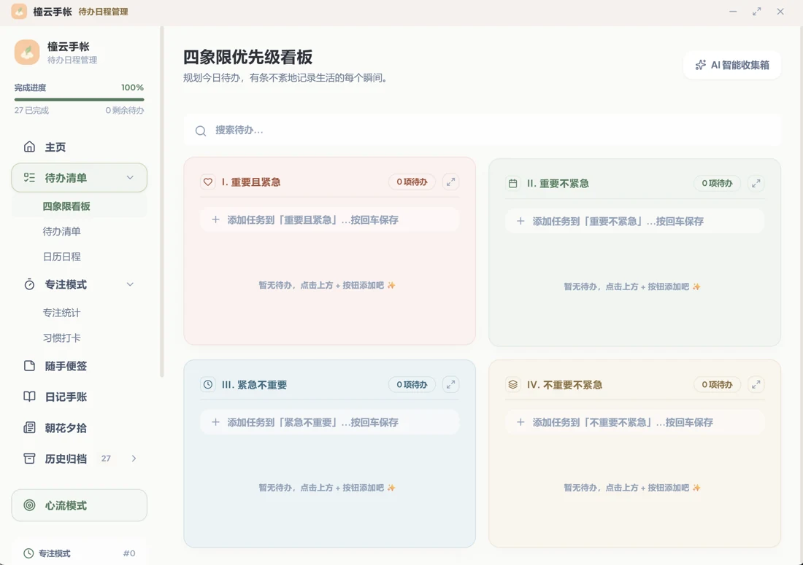

# 卓橦 · Tongyun

独立开发者。我做本地优先的桌面应用，也在记录一个人怎样和 AI Agent 一起把软件做出来、测清楚、交付给用户。

[个人网站](https://dangzhuotong.github.io/) · [博客](https://yibz.netlify.app/) · [邮件](mailto:353199054@qq.com)

## 橦云手帐

把四象限待办、翻页日记和番茄钟放进一本桌面手帐。数据默认留在本机，可选 WebDAV 同步。手帐用 Tauri 2、Rust 和 React 构建，支持 macOS、Windows 和 Linux。

[源码](https://github.com/dangzhuotong/tongyun-planner) · [下载](https://github.com/dangzhuotong/tongyun-planner/releases/latest)

## 也在做

- [橦云工作台](https://github.com/dangzhuotong/tongyun-studio) — 在同一个桌面工作空间里看文件、跑项目、调接口、查数据库、审 Git 差异。
- [橦云接口](https://github.com/dangzhuotong/tongyun-api) — 把 API 请求存为仓库里的纯文本，让接口用例和代码一起审查。
- [橦云脚手架](https://github.com/dangzhuotong/tongyun-scaffold) — 为新项目准备目录、文档和 Agent 协作约定。

## 一人团队怎么工作

我先定范围和验收标准，再让 Agent 分担开发、回归和文档。把改动留在独立分支，带上测试结果和截图交审，最后由我确认可以合并什么。重复的操作整理成 [TongSkills](https://dangzhuotong.github.io/products/tongyun-skills.html)，目前作为私有技能库用于自己的工作流。
